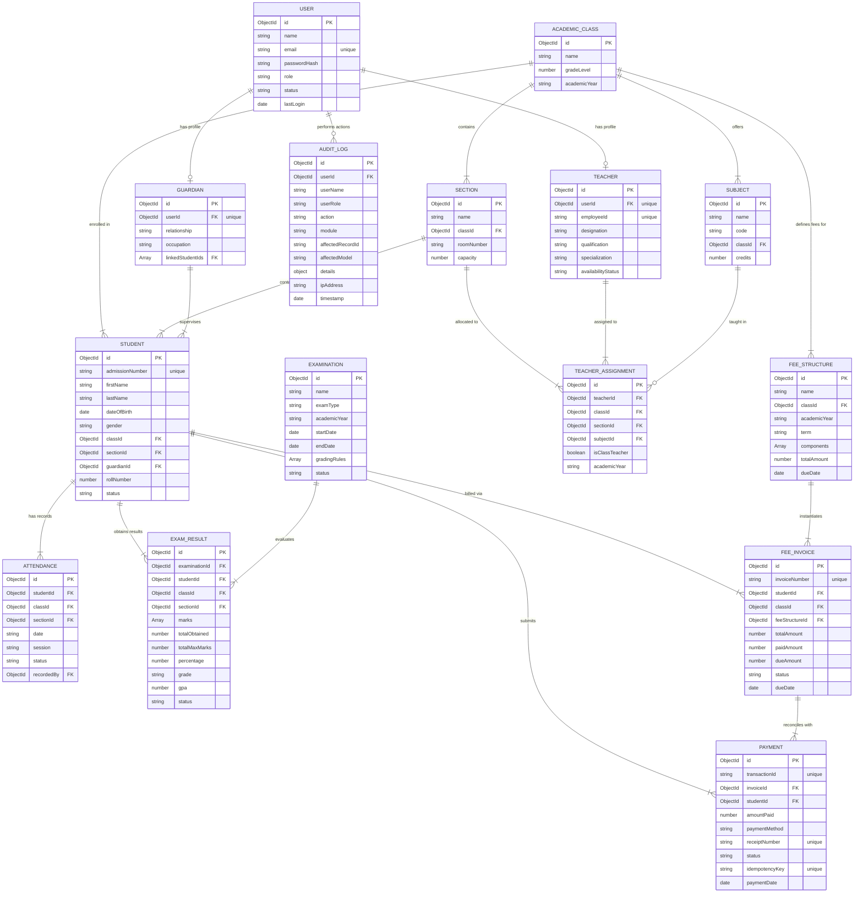

# Database Schema & Entity-Relationship Architecture

## ScholaVerse Academic Operations Platform

This document describes the persistence layer architecture designed for MongoDB using Mongoose ODM, detailing schemas, foreign reference ObjectIds, indexing strategies, and uniqueness constraints.

---

## 1. Entity-Relationship Diagram (Mermaid)

---

## 2. Key Indexes & Constraint Guarantees

1. **Duplicate Attendance Elimination**
   - Compound Unique Index: `{ studentId: 1, date: 1, session: 1 }` with `unique: true`
   - Guarantees at database level that duplicate records cannot be generated on the same date and session.

2. **Teacher Assignment Boundaries**
   - Compound Unique Index: `{ teacherId: 1, classId: 1, sectionId: 1, subjectId: 1, academicYear: 1 }` with `unique: true`

3. **Exam Result Uniqueness**
   - Compound Unique Index: `{ examinationId: 1, studentId: 1 }` with `unique: true`
   - Guarantees one comprehensive result per student per exam cohort.

4. **Fee Ledger Idempotency & Reconciliation**
   - Unique Index: `transactionId`
   - Sparse Unique Index: `idempotencyKey` prevents duplicate transaction submissions.
   - Reconciled: `invoice.paidAmount` is strictly equal to the sum of all `COMPLETED` payments.
